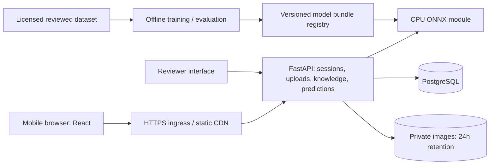

# Philippine crab identification: implementation and release plan

Decision baseline: 18 October 2026. Targets below are proposed acceptance criteria, not measured model performance. The repository implements a local vertical slice; external data rights, trained weights, expert review, and public infrastructure remain release dependencies.

## 1. Executive recommendation

Launch an identification assistant for **8–12 curated Philippine species**, with explicit abstention. Use one React application, one FastAPI service containing CPU inference and knowledge lookup, PostgreSQL, and private object storage. The current repository uses local files for the executable baseline and SQLite by default; Compose exercises PostgreSQL.

Recommendation: compact pretrained classifier with confidence calibration and independently tuned rejection. Reason: bounded labels and a small team. Alternatives: detection pipeline, embedding retrieval, multimodal generative API. Tradeoff: users must frame one crab clearly; novel/lookalike crabs remain difficult. Revisit when measured crop failures dominate errors or class expansion justifies retrieval.

Never interpret softmax confidence as certainty over all species, or as food safety. Never force an unknown animal into a supported class. No validated model is presently included.

## 2. Assumptions and unresolved risks

- Initial audience: learners, coastal observers, and field staff using mobile browsers; no harvest/consumption authorization.
- Budget assumption: two engineers plus a contracted crustacean taxonomist and regional-language contributors; modest initial traffic, approximately 1 request/second sustained and 5 concurrent uploads.
- No assumption of a ready-made, legally reusable Philippine image dataset. Counts must be measured after licensing, deduplication, and expert review.
- Species identity may require features not visible in one photo, maturity, specimen examination, or molecular work. An expert may legitimately label only genus.
- Regional variation, sex, molt, juveniles, wet shells, lighting, cooked specimens, market backgrounds, and camera types can create distribution shifts.
- Model pretraining can contain related internet imagery. Group splitting reduces project leakage but cannot prove a pretrained model never encountered a test image. Commission new test observations after choosing the backbone.
- Local names are many-to-many, not translation keys. Do not manufacture a Tagalog or Cebuano name for every taxon.

## 3. MVP scope

Included: one image/one crab, JPEG/PNG/WebP, top-3 candidates when available, model version, quality warnings, unknown reason, safe additional-photo guidance, cited species pages, private browser-session history, correction queue, dataset review, and operator rollback.

Not MVP: all Philippine crabs, cooked/processed crab identification, mixed catches, automated edibility advice, public image galleries, exact GPS, offline inference, multi-view fusion, promised live expert responses, or training on user feedback.

Recommendation: anonymous cookie sessions rather than accounts. Reason: low friction and less personal data. Alternative: OIDC for all users. Tradeoff: history is browser-specific and lost when its cookie is cleared. Revisit for requested cross-device history. Reviewer identity must use OIDC/MFA before multiple reviewers are onboarded; the current shared key is only a local MVP access mechanism.

## 4. Recommended initial species list-selection process

1. Compile 20–30 candidate taxa from Philippine occurrence records, regional experts, and fisheries references.
2. Resolve each accepted taxon concept through WoRMS; retain original source name, provider ID, accepted ID, synonyms, taxon authority/version, and resolution date. Never merge a historical species complex by string matching alone. [WoRMS REST service](https://www.marinespecies.org/rest/).
3. Score candidates on independently verified local presence, encounter frequency, visible diagnostic traits, available licensed observations, lookalike ambiguity, and conservation/safety importance.
4. Have two experts independently identify a blinded sample of ordinary mobile photos. Exclude species-level classes where diagnostic evidence or agreement is inadequate; permit an explicitly labeled genus-level abstention in a later hierarchy.
5. Select 8–12 only after the audit. Aim for at least 700 independent observations per class, including roughly 100 sealed test observations; these are collection targets, not guaranteed sufficient samples. Reduce the release class count if supply fails.
6. Include out-of-scope regional lookalikes and non-crabs in rejection development and test sets. Hold out entire unknown taxa, not merely new pictures of the same unknown taxa.

Candidate audit priorities include Scylla serrata, S. olivacea, S. tranquebarica, Portunus pelagicus, and expert-nominated visually distinctive species. Do not force the three Scylla species into separate release classes if their required traits are absent. SEAFDEC reports juvenile identification difficulty. [SEAFDEC expert account](https://www.seafdec.org.ph/2020/expert-warns-crab-farmers-against-fake-king-crablets/).

Zosimus aeneus and Atergatis floridus belong in the safety-focused challenge set whether or not they become supported classes; BFAR names both in a regional poisonous-crab advisory. Their absence from a prediction never implies safety. [BFAR Region 5 advisory](https://region5.bfar.da.gov.ph/2023/07/31/bfar-5-raises-awareness-regarding-the-hazards-of-poisonous-crab/).

Recommendation: data/identifiability gates decide classes, rather than a fixed popular-species list. Tradeoff: reduced marketing coverage. Revisit class inclusion after new licensed observations and independent blind evaluation. Expand in batches of 2–4; rerun all existing-class and OOD gates.

## 5. Dataset acquisition and licensing plan

| Source | Quality / labels / Philippine relevance | Access, metadata, rights, duplicates |
|---|---|---|
| iNaturalist | Variable field photos; research-grade is useful evidence, not expert ground truth. Filter Philippine observations and inspect visible diagnostic structures. | API for bounded queries; bulk access by official export/agreement. Preserve observation/photo IDs, creator, identification history, location visibility, date, and separate photo license. High same-observation and GBIF overlap. Training and redistribution require eligible photo-level rights; no license means exclude. |
| GBIF | Occurrence aggregation; some records have no photographs or non-diagnostic specimens. Useful local-presence and provenance metadata. | Official Darwin Core Archive downloads with DOI; inspect multimedia records. Occurrence license does not automatically license images. Deduplicate against iNaturalist and original publisher. Map taxonomic concepts, not just GBIF name strings. |
| Wikimedia Commons | Often good resolution, but curated/documentary bias and nonexpert labels; Philippine coverage uneven. | MediaWiki API and per-file license/author history. Check the original creator, attribution, derivative conditions, and source. CC BY-SA requires policy review for affected outputs; do not assume every file has the same license. Many cross-posted images. |
| NOAA/government repositories | Often strong institutional provenance; NOAA geographic coverage is usually not the Philippine target. Captions may identify only genus. | Official downloads/APIs where provided. Verify every credited asset; government hosting is not blanket public-domain permission. Retain specimen/catalog links and source dates. Third-party material may carry separate rights. |
| Philippine biodiversity databases | Best starting point for geographic relevance; dataset freshness, crab image density, and label verification vary. | PhilCHM/BMB, BFAR, museums, universities, SEAFDEC: use official downloads or request access. Check dataset-specific policy, partner rights, identifiers and updated taxonomy. Do not interpret access to a PDF as permission to extract training photographs. |
| Expert-contributed photographs | Most useful for difficult morphology, juveniles and controlled multi-view observations; can overrepresent laboratory conditions. | Written agreement covering training, internal retention, display, derivatives and redistribution separately. Record specimen/observation IDs, photographer, reviewer and collection method. Multiple views remain one observation group. |
| Licensed institutional/commercial data | Potentially consistent quality and labels, but must audit with experts; local coverage is contract-specific. | Negotiate ML training and deployment/model rights explicitly, redistribution and expiration terms, permitted jurisdictions, provenance and takedown process. Purchase only after a sample-label and diversity audit. |

For the first acquisition batch, prefer explicitly cleared CC0/CC BY photos and contracted expert contributions. Exclude NC/ND, unknown, or ambiguous permissions from commercial-use candidates pending legal review. Record `training_rights`, `public_display_rights`, `redistribution_rights`, legal-review evidence and restrictions independently; “downloadable” is not a rights decision. Do not publish a raw image dataset by default. Attribution exports accompany permitted redistributions.

iNaturalist asks for about 1 request/second, around 10,000 API requests/day, and discourages bulk API collection. Set the collector below those limits, use an identifying User-Agent, cache results, honor Retry-After, and stop on sustained errors. [Official recommended practices](https://www.inaturalist.org/pages/api+recommended+practices).

GBIF multimedia may have more restrictive licenses; retain the underlying occurrence link and download DOI. Its image cache requests a single scripted connection. [GBIF image API](https://techdocs.gbif.org/en/openapi/images), [citation guidance](https://www.gbif.org/citation-guidelines).

Commons requires per-asset verification and license compliance. [Commons reuse policy](https://commons.wikimedia.org/wiki/Commons:Reusing_content_outside_Wikimedia/en). NOAA has image-use guidance; inspect credits and exceptions. [NOAA usage information](https://www.omao.noaa.gov/image-licensing-usage-info). PhilCHM describes its data holdings and policy; confirm partner-specific permissions. [PhilCHM database](https://www.philchm.ph/database/), [information policy](https://www.philchm.ph/information/).

No uncontrolled scraping is recommended. If a specific provider grants scraping access: document terms/robots review, use one connection at no more than one request every two seconds unless instructed otherwise, obey stricter published limits and Retry-After, retain source/terms snapshots and timestamps, deduplicate, and manually audit labels/rights before admission. Robots compliance alone does not grant reuse rights.

Recommendation: curated acquisition over image-search scraping. Tradeoff: slower acquisition and expert cost. Revisit only through explicit publisher access agreements, not bypassing quotas.

## 6. Dataset and knowledge-base schemas

Dataset manifest record (JSONL, immutable per release):

```json
{
  "image_id": "immutable-uuid", "source_url": "https://provider/image",
  "observation_url": "https://provider/observation", "provider": "expert",
  "provider_image_id": "original-id", "object_key": "licensed/uuid.jpg",
  "scientific_name": "source name", "species_id": "internal-stable-id",
  "taxon_id": "authority:accepted-id", "taxon_version": "snapshot-id",
  "common_names": [], "coarse_region": "province, if permitted",
  "observation_date": "2026-01-01", "creator": "rights holder",
  "license": "CC-BY-4.0", "license_evidence_url": "https://provider/license",
  "training_rights": true, "public_display_rights": false,
  "redistribution_rights": false, "label_confidence": "high",
  "verification_status": "expert_reviewed", "reviewer_ids": ["reviewer-id"],
  "split": "unassigned", "observation_group": "provider:observation-id",
  "leakage_group": "assigned-by-splitter", "sha256": "64-hex-digits",
  "perceptual_hash": "16-hex-digits", "collected_at": "ISO-8601 UTC",
  "sex": "unknown", "life_stage": "unknown", "view": "dorsal",
  "quality": [], "label_evidence": ["citation-id"]
}
```

The admin intake implements the core provenance subset. It does not fetch/validate remote objects. The offline training manifest additionally needs `image_id`, `species_id`, reviewer validation, and split/group fields. Verify file checksums, rights evidence and taxonomy before export. Do not infer legal reuse from boolean fields alone.

Knowledge base: stable internal `id`; accepted taxon ID/rank/authority; scientific name and synonyms/history; versioned name assertions; diagnostic traits and required views; habitat; distribution; size with unit/measurement type/sex/stage; coloration; sex/stage differences; lookalikes with distinguishing traits; common uses/ecological roles; safety assertions; conservation assessments; jurisdiction-specific regulation assertions; claim-level citations; review status/person/date; revision.

Name assertion: `{name, language (en/tl/ceb/etc.), region, spelling_variants, scope (species/genus/market_group), source_id, status}`. Shared names such as market categories must not become unique species aliases. Display “no reviewed local name” instead of auto-translating.

Enumerations:

- `edibility`: edible | conditionally_edible | not_recommended | unknown.
- `toxicity`: non_toxic_known | toxic | potentially_toxic | unknown. `non_toxic_known` needs bounded evidence and never guarantees an individual safe.
- `venom_status`: documented | not_documented_in_reviewed_sources | unknown. Distinguish envenomation from ingestion hazards and physical injury.
- `identification_status`: verified | expert_reviewed | provisional.
- `review_status`: pending | reviewed | disputed | stale.
- `conservation_status`: EX | EW | CR | EN | VU | NT | LC | DD | NE | not_reviewed. Store assessor, assessment date, scope, source, and access date separately; missing data is not LC or NE.

Safety claims include region, evidence strength, adverse/contradicting evidence, source, reviewer, review date and expiry. Regulations include jurisdiction, effective dates, source section, superseding instruments, species/life-stage applicability and `unknown/not_reviewed`. The initial seed intentionally leaves most facts unknown and last-reviewed null.

Conflicting sources remain separate assertions and move the aggregate to `disputed`; suppress affirmative safety conclusions until expert resolution. Prefer primary taxonomic/official sources over unsourced common-name pages; preserve old assertions in the audit trail.

Recommendation: species documents in PostgreSQL JSON with stable relational IDs initially. Alternative: fully normalized assertion graph or an external CMS. Tradeoff: validation and indexing need explicit care. Revisit when concurrent editors, multilingual publishing, or evidence relations become complex. Add schema migrations and document validation before evolving production records; `create_all` in the prototype is not a migration strategy.

## 7. ML architecture and training workflow

| Option | Decision, reason and tradeoff | Revisit trigger |
|---|---|---|
| Standard classification | Start here: pretrained EfficientNet-B0, 224-pixel letterbox input, known species logits. Low serving complexity; small anatomical features may be lost. | Expert-confirmed failures due to missing detail; benchmark 384/448-pixel backbones. |
| Fine-grained classification | The task is fine-grained, but specialist parts/attention losses are later experiments, not a separate initial service. | Sufficient labels for diagnostic structures and consistent gains on sealed lookalike tests. |
| Detection + classification | Defer. Ask users to frame one crab. Detecting/localizing adds annotations and another failure mode. | Multiple animals or clutter cause a substantial measured share of failures. |
| Embedding similarity | Useful offline for duplicate discovery and reviewer search; neighbors are not taxonomic proof. | Review throughput bottleneck and a licensed, vetted gallery. |
| Classifier + retrieval | Later: show attributed comparison examples and distance diagnostics. Additional rights and runtime complexity. | Retrieval demonstrably improves review outcomes and selective risk. |
| Human review | Required for labels, safety facts and releases. Optional user feedback has no promised response SLA. | Funded expert support can support explicit response commitments. |

Training procedure:

1. Quarantine acquired images; validate rights, decode, hash and label. Record disagreements. Two experts adjudicate ambiguous classes and a stratified subset; use genus/unknown labels when warranted.
2. Deduplicate exact bytes and decoded-content hashes, perceptual hashes and embedding neighbors. Connect all photos from an observation, burst/specimen and suspected duplicates before splitting. Cross-source matching is mandatory. Human-review near matches rather than assuming similarity proves identity.
3. Freeze grouped train/validation/calibration/test assignments around 60/15/10/15. The supplied splitter also keeps photographers together; this is conservative and may create large groups. Inspect class coverage rather than accepting percentages blindly. Reserve a separately commissioned Philippine field-test cohort plus unknown-species development/test sets. Geographic and temporal holdouts are separate reports.
4. Use train only for fitting; validation for architecture/early stopping. Weight loss by inverse square-root class frequency initially; compare with balanced sampling, never combine aggressive weighting/sampling blindly. Preserve natural class frequencies in deployment evaluation.
5. Use modest geometry/lighting augmentation validated against diagnostic traits. Do not aggressively recolor distinguishing features. Split before augmentation; synthetic derivatives never become independent test observations.
6. Calibrate temperature on the calibration split. The supplied trainer exports an unapproved candidate; it does not tune OOD policy or run the final test. [Temperature-scaling research](https://arxiv.org/abs/1706.04599).
7. Tune confidence, margin, energy and quality rejection on a separate policy-development set. Softmax threshold alone is insufficient. Include regional out-of-scope lookalikes, non-crabs, juveniles, cooked fragments, illustrations and poor photos. Energy is a useful baseline, not a guarantee of novelty detection. [Energy OOD research](https://arxiv.org/abs/2010.03759).
8. Evaluate the fixed model and fixed rejection policy on sealed known/unknown tests. A supported class deliberately withheld from training is useful research evidence but not the only OOD test.
9. Export ONNX, check preprocessing and numeric parity, checksum the bundle, document thresholds and evidence, and obtain model/data/expert approval. Loader refuses unapproved or inconsistent bundles. Quantization requires recalibration and reevaluation.

Error analysis must separate wrong species, overconfident unknown acceptance, correct-but-rejected cases, taxonomy problems, diagnostic feature absence, and background/source shortcuts. Review by region/source/stage/sex/view and confidence band; report support and uncertainty intervals.

Recommendation: CPU ONNX colocated in FastAPI for MVP. Alternative: PyTorch/GPU service. Tradeoff: bounded throughput and shared API resource use. Revisit after profiling sustained load or memory isolation. The implementation limits concurrent predictions to two; production decoding should run in bounded isolated processes with time/memory limits.

## 8. Web application architecture



Frontend: Vite React TypeScript; Next.js considered but SSR is unnecessary for the upload flow. Tradeoff: public guide SEO is weaker; revisit if searchable educational content becomes a primary acquisition channel. Accessible semantic forms, visible uncertainty, keyboard controls, and responsive layouts are implemented.

Backend: FastAPI with typed Pydantic requests; synchronous prediction fits an interactive CPU budget. Keep knowledge lookup, auth, inference and feedback in one application initially. Separate training entirely. Add a durable job queue and `202 + polling` only if scan/inference latency exceeds the synchronous budget; do not acknowledge a background job before durable enqueue.

Storage: local private files for this slice, S3-compatible object storage for production. PostgreSQL stores references/results; immutable dataset storage uses separate credentials/bucket. Public reviewed reference media may use a CDN; user uploads must never use public CDN URLs. Region selection should be based on measured Philippine latency, residency review and backup needs.

Admin UI is part of the frontend; authorization is on every backend admin endpoint. No secret is embedded at build time. Analytics collect aggregated outcomes and latency without images, EXIF, exact locations or feedback text. Add OpenTelemetry/Prometheus and scrubbed error tracking before public operations.

## 9. API contract

All paths begin `/api`; OpenAPI at `/docs` is executable documentation. `GET /session` issues an HttpOnly cookie and CSRF token. Mutations require `X-CSRF-Token`; admin endpoints additionally require `X-Admin-Key`. Cross-user record access returns 404.

| Endpoint | Contract / result |
|---|---|
| GET `/session` | Session cookie; `{csrf_token, history_retention_days, image_retention_hours}`. |
| POST `/uploads` | Multipart `file`; JPEG/PNG/WebP, <=10 MiB, each side >=224, <=24 MP, longest side <=12000, single frame. Returns 201 `{id,width,height,warnings,sha256,expires_at,training_consent:false}`. |
| GET `/uploads/{id}/image` | Owner-only sanitized JPEG, or 410 after expiry. |
| POST `/predictions` | `{upload_id,top_k:1..5}`; synchronous 201 result. Two concurrent inference slots, 503/Retry-After on saturation. |
| GET `/predictions?limit=20&offset=0` | Owner history; limit 1–100. |
| GET/DELETE `/predictions/{id}` | Owner result; deletion removes linked photo/feedback, 204. |
| GET `/species`, `/species/{id}` | Versioned knowledge documents with names, uncertainty and citations. |
| POST `/feedback` | `{prediction_id,suggested_species_id?,note:3..2000 chars}`; 201 pending, never training eligible. |
| GET `/admin/reviews` | Up to 100 pending corrections. |
| POST `/admin/reviews/{id}` | `{decision:accepted/rejected/needs_expert,note:10..2000 chars}`; audited transition, 409 if already resolved. |
| GET/POST `/admin/dataset` | Reviewed-provider metadata intake and queue. No arbitrary remote fetch. |
| POST `/admin/dataset/{id}/review` | Audited review; accepted records remain unassigned to a split. |
| GET `/model` | Availability, version, supported IDs and dataset version. |
| GET `/health`, `/ready` | Liveness; database/model capability readiness. Development can be ready with inference unavailable; production requires a bundle at startup. |

Illustrative response shape below shows the actual no-model behavior; no fictional species probabilities:

```json
{
  "id":"prediction-uuid", "request_id":"request-uuid", "upload_id":"upload-uuid",
  "status":"insufficient_information", "reason":"model_unavailable",
  "model_version":"unavailable", "candidates":[],
  "ood":{"detected":null,"score":null,"method":"not_evaluated"},
  "quality_warnings":["possible_blur_or_low_detail"],
  "suggested_photos":["dorsal","side","claw","legs","carapace","ventral_if_safely_visible"],
  "safety_disclaimer":"Do not consume a crab based solely on model output."
}
```

With a validated bundle, each candidate has `{species_id,scientific_name,names:[{name,language,region,scope,status}],confidence,knowledge_revision,sources:[{id,title,url}],last_reviewed}`. Confidence is a calibrated distribution over supported classes; truncated top-k need not sum to one. OOD energy is a score, not an unknown probability. Candidate scores on an abstention are comparison suggestions, not accepted identities. Poor image quality and OOD are distinct reasons; neither proves a new species.

Errors: structured `{request_id,error:{code,message,fields?}}`; 401 session, 403 CSRF/origin/reviewer, 404 missing or unowned record, 409 review conflict, 410 expired image, 413 size, 415 unsupported image, 422 invalid input/scan rejection, 429 rate, 503 unavailable scanner/inference capacity. Infrastructure exceptions must be scrubbed and correlated by request ID. Add idempotency keys and bounded retries before paid/high-volume clients; the current UI does not automatically retry POSTs.

## 10. Security and privacy plan

Implemented: byte/decode checks, image dimension and animation limits, EXIF stripping/reencoding, random object keys, owner authorization, session token hashes, SameSite cookies, CSRF headers, origin allowlist, reviewer secret checks, audit events, input length constraints, rate limits and concurrency bounds. Production scanning fails closed if ClamAV cannot approve content. Never accept arbitrary image URLs from public users (SSRF).

Before public deployment: isolate decoding with CPU/memory/time quotas, enforce ingress body/time limits, use TLS and secure cookies, OIDC/MFA and reviewer roles, secrets manager, private buckets with short-lived signed access, encrypted backups, audited restore/delete drills and distributed limits. Do not trust arbitrary proxy headers. The supplied in-process limiter is per process and not a distributed production control.

Do not collect precise coordinates. Optional future coarse province input needs purpose and consent; strip embedded EXIF regardless. Never log uploaded bytes, cookies, API keys, precise locations or correction text in telemetry. Keep audit IDs and decisions with access restrictions; define retention before public rollout.

Images: inaccessible at 24h, hourly cleanup; anonymous result metadata: 30 days; bounded encrypted backup retention proposed at 30 days with deletion tombstones reapplied on restore. Explicit deletion includes feedback. Licensed external training data has a separate retention/rights policy. User training opt-in is intentionally not implemented: no user photos are promoted.

Philippine privacy obligations require purpose limitation, proportionality and bounded retention; conduct a deployment-specific privacy assessment rather than treating a checklist as legal clearance. [National Privacy Commission: Data Privacy Act](https://privacy.gov.ph/data-privacy-act-/).

No generative AI is used. If added later, treat OCR, captions, retrieved text and user notes as untrusted data; prohibit tool execution from model-generated instructions and ground factual output in reviewed KB assertions. Do not delegate safety conclusions to a language model.

## 11. Evaluation and acceptance criteria

All model gates use observation groups as independent units and report sample counts plus bootstrap/Wilson 95% intervals. Do not count multiple views as independent test samples. Fix metrics/thresholds before opening the sealed test.

| Metric | Proposed public-beta gate |
|---|---|
| Closed-set top-1 / top-3 | >=85% / >=95% on supported, in-scope field images before rejection. |
| Macro F1 | >=0.85; every released class precision >=0.85, recall >=0.75, F1 >=0.80. |
| Accepted predictions | >=95% accuracy with lower 95% bound >=90%; coverage >=60% overall so rejecting everything cannot pass. Report class-level acceptance/coverage. |
| Near-OOD false acceptance | <=5% point estimate and upper 95% bound <=10%, with >=200 independent regional lookalike observations. |
| Far-OOD false acceptance | <=1% point estimate and upper bound <=3%, with >=300 independent non-crab/irrelevant images. |
| Calibration | 15-bin ECE <=0.05, plus reliability plots, Brier score and NLL on all known-class predictions; compare before/after temperature scaling. |
| Poor-quality/partial images | >=90% abstention on expert-marked unidentifiable images; accepted-error rate <=5% where identifiable. Report reduced coverage explicitly. |
| Geography/stage/source | Every advertised cohort has >=50 independent observations and accepted accuracy >=90%; gaps >10 percentage points require remediation or explicit scope restriction. Juveniles stay unsupported if evidence is insufficient. |
| Per-class test support | Target >=100 independent observations per class. Wide intervals or unsupported cohorts block claims even if point estimates pass. |
| Server inference | p95 <=1 second warm CPU model time; p95 <=3 seconds post-upload processing including validation/scan at reference load; p99 <=8 seconds. |
| End-to-end mobile | Target <=10 seconds for a 2 MiB image on a defined 5 Mbps/100 ms network; publish network assumptions. |
| Upload limit | 10 MiB / 24 MP / 12000 longest side, verified server-side. |
| Availability | Initial public SLO 99.5% monthly API success excluding intentional 4xx; >=99.9% later if support/resources justify. |
| Accessibility | WCAG 2.2 AA audit: keyboard, focus, labels, announcements, contrast, no color-only confidence, 200% zoom and 320px reflow. |
| Mobile | Real iOS Safari and Android Chrome camera/upload tests, low-memory handling, portrait/landscape and touch targets. |
| Code testing | Backend >=85% statements, inference/policy >=90% target before model release, frontend >=80% critical-flow branches plus contract/E2E coverage. Coverage alone cannot pass a release. |

Hard blockers: rights/provenance, leakage, supported class metrics, OOD/accepted-risk, safety claims, privacy/access control, decoder/scanner failure behavior and basic accessibility. Monitor post-release: regional mix, quality rejection, drift signals, cost and queue times. Material regressions reopen gates. No metric currently claims model validity; there is no released classifier.

## 12. Deployment and operations plan

Development: local Vite/FastAPI and SQLite, or Compose with PostgreSQL. Production: one managed container deployment for API/inference, managed PostgreSQL, private object storage, static frontend/CDN and TLS ingress. Docker images run as non-root. Training runs on isolated GPU jobs with access only to approved manifests.

Use CI for tests/build/dependency scans, staging contract and mobile smoke tests, migrations, and immutable image/bundle deployment. Model registry can initially be versioned object storage plus an approved release manifest; MLflow considered but deferred until experiment volume demands it. Record code commit, data manifest hash, weights hash, preprocessing, calibration, thresholds, taxonomy version and evaluation report.

Deploy canary traffic, compare errors/latency/abstention against the previous release, then promote. Rollback swaps the entire bundle and compatible container, not weights alone; maintain old class mappings and KB revisions for historical results. Run rollback drills. KB safety corrections can deploy independently with an audit trail.

Recommendation: managed containers rather than Kubernetes. Tradeoff: less scheduler flexibility, substantially less maintenance. Revisit with several independently scaled services or sustained GPU serving. Proposed recovery objectives: RPO 24h, RTO 4h; validate backups against these targets before promising them.

## 13. Admin and expert-review workflow

Acquisition -> quarantine -> rights verification -> taxonomy resolution -> independent label review -> disagreement adjudication -> accepted dataset record -> duplicate grouping -> frozen split -> training eligibility. Every transition preserves actor, timestamp, evidence and revision.

Feedback is a separate queue. A correction may be accepted as useful evidence without establishing a training label or granting photo rights. Current user uploads always remain training-ineligible. Prioritize high-confidence disagreements, lookalike confusions, OOD false acceptance, underserved regions and random samples of accepted predictions. Avoid sampling only low-confidence cases.

KB workflow: contributor proposes assertion -> taxonomist/language/safety reviewer as appropriate -> publish revision -> scheduled re-review. Safety/regulatory entries require source-level verification; stale statements become visibly stale/unknown. The seed has no fabricated expert reviewer or review date. The initial UI supports correction/dataset review; KB publication remains version-controlled until role-aware editorial tooling exists.

## 14. Phased implementation roadmap

| Phase | Deliverable and exit criterion |
|---|---|
| 0: feasibility | 20–30 candidate audit, 3-class pilot, rights ledger, expert identifiability report; go/no-go on species-level claims. |
| 1: vertical slice | Upload -> sanitize -> abstain or validated inference -> cited result -> history/feedback -> review. This repository implements the no-model slice. |
| 2: dataset/model | 8–12 classes only if evidence supports them; frozen splits, baseline, calibration, unknown challenge sets and evaluation report. |
| 3: private pilot | Experts and invited observers, independently collected photos, mobile/accessibility review, error taxonomy, rights corrections. |
| 4: production hardening | Object storage, decoder isolation, OIDC/MFA, migrations, telemetry, backup/deletion drills, load tests and canary/rollback. |
| 5: expansion | Add 2–4 classes per gated release; consider detection, retrieval and multi-view only when measured errors justify them. |

## 15. Repository structure

```text
frontend/           React interface, API client, types, component tests
backend/            FastAPI, storage models, schemas, sanitization, inference
backend/seed/       Provisional cited species knowledge (no model labels assumed)
ml/                 Reviewed-manifest splitting and offline baseline training/export
tests/              API, ownership, upload, policy, review and split tests
docs/               Production plan, decisions, remaining release gates
deploy/             Local reverse-proxy configuration
.github/workflows/  Automated tests/build/audit
Dockerfile*         API and frontend builds
compose.yaml        Local PostgreSQL/API/frontend/retention worker
```

## 16. Testing strategy

Unit: abstention precedence, calibrated normalization, finite output/shape checks, path bounds, hashes, split connectivity, rights gates, quality checks and expiry. Contract: typed requests, missing model, errors, species citations, history and review transitions. Security: spoofed MIME, malformed/oversized/animated/decompression-bomb inputs, CSRF, malicious origins, session isolation, unauthorized review and scanner outage. No unsafe fixture downloads.

Integration: actual PostgreSQL, private storage lifecycle, ClamAV INSTREAM behavior, concurrent deletion/review and model loading. E2E: mobile upload/camera, delayed API, retry affordances, keyboard/focus, empty results, feedback, delete and review. Inference release: PyTorch/ONNX numeric parity and complete locked evaluation; mocked logits test code, not biological accuracy.

The initial tests exercise the local slice. Training on real photographs, scanner integration, browser E2E and actual model accuracy require their corresponding services/assets; do not replace those checks with fabricated outputs.

## 17. Monitoring and retraining strategy

Record aggregate request latency, 4xx/5xx, scan failures, decode failures, inference saturation, model version, class histogram, quality flags, rejection reasons and calibrated confidence bands. Never include image bytes or exact GPS. Separate API availability from model abstention.

Alert on 5xx >2% for 5 minutes, p95 post-upload latency >3s for 15 minutes, scanner failure, cleanup lag >2 hours, and large unknown/quality rate changes relative to a weekly baseline. Drift alerts initiate investigation; they do not prove accuracy loss. Use consented, independently reviewed pilot samples to measure actual errors.

Review data monthly; retrain quarterly or when an adjudicated failure cluster/new taxon materially changes coverage. No automatic feedback ingestion or automatic deployment. Freeze datasets and benchmark versions, recalibrate each candidate, and reopen safety/lookalike gates. Retraining cannot erase the need for expert labels. Revoke or correct licensed assets according to the rights process and assess affected models with counsel.

## 18. Estimated complexity by phase

Planning estimates for two engineers plus available domain experts, not delivery promises:

| Phase | Engineering effort | Calendar risk |
|---|---|---|
| Feasibility | 1–2 engineer-weeks | 2–6 weeks for expert/rights availability. |
| Application vertical slice | 2–4 engineer-weeks | Low–medium; model capability is separate. |
| Acquisition/adjudication | 4–8 engineering weeks supporting curators | 6–16+ weeks; likely critical path. |
| Baseline/evaluation | 3–5 ML engineer-weeks | Data-dependent; results may reduce scope. |
| Private pilot/hardening | 4–6 engineer-weeks | 3–6 calendar weeks with review access. |
| Expansion | 2–4 engineer-weeks per batch | New data and taxonomy uncertainty dominate. |

Training hardware is unlikely to be the largest cost at this scale. Budget expert annotation, licensing, local collection, quality assurance and ongoing source review before optimizing GPU spend. Obtain actual hosting/annotation quotes after workload and candidate counts are known.

## 19. Explicit tradeoffs and rejected alternatives

- Reject “all crabs”: no defensible class coverage or unknown boundary. Revisit only through incremental evidence.
- Reject always returning a species: abstention reduces coverage but makes the uncertainty visible. Revisit thresholds only with measured selective-risk improvements.
- Reject a universal “other” class as the only OOD mechanism: it cannot enumerate the open world. Use diverse unknown evaluation and calibrated rejection.
- Reject LLM-generated species/safety prose: reviewed KB assertions are auditable; editorial maintenance costs more. Revisit only for constrained, cited explanations after separate evaluation.
- Defer detection and vector databases: insufficient evidence they solve the first failure modes. Revisit on error analysis and reviewer needs.
- Defer user accounts and public images: lower privacy/abuse surface; history is less portable. Revisit with a clear user benefit and consent model.
- Keep inference and API together initially: simpler deployment; bounded throughput. Split when load/resource isolation justifies another service.
- Keep the dataset and knowledge base separate: factual corrections need no retraining; two versioned systems require explicit provenance joins.

## 20. Risks requiring expert validation

Taxonomist: accepted concepts/synonyms, Philippine occurrence, diagnostic keys, Scylla distinctions, juveniles, sexual dimorphism and unknown lookalikes. Regional-language reviewers: Tagalog/Cebuano/other names, geographic scope and spelling variants. Food-safety expert: evidence strength, toxin geography and wording; absence of toxin evidence must remain unknown. Conservation/legal reviewers: assessment scope and current national/local restrictions.

Regulatory notes must check amendments and local rules rather than hard-code an old fisheries order. BFAR maintains the current administrative-order index. [BFAR administrative orders](https://www.bfar.da.gov.ph/laws-regulations-issuances/administrative-orders/).

Rights/privacy reviewers: training/display/redistribution grants, contracts, pretraining lineage, consent, retention and backup deletion. Operational reviewers: incident response, OOD limitations, image-decoder isolation and release rollback.

**First milestone:** collect 150 independent, explicitly licensed observations for each of three expert-selected visually distinguishable candidate species, plus 150 regional lookalike/non-crab challenge observations. Freeze grouped pilot splits, have experts blindly assess identifiability, and run the upload-to-abstention interface against those images. Deliver the rights ledger, deduplication report, label disagreement report and baseline feasibility results. This validates the collection and application path; it is not sufficient evidence for a public identification release. Expand toward the per-class test and release gates only if this milestone supports species-level identification.
